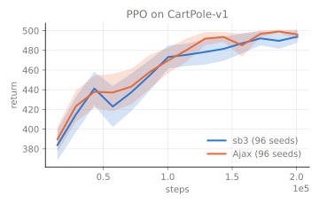
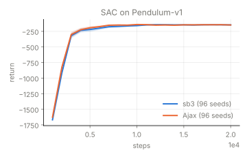

<h1 align="center">Ajax</h1>

<p align="center">
  <b>Fast, modular reinforcement learning in JAX.</b><br/>
  The environment, the agent and every seed run together in one program, on a CPU or a GPU, and agents are built from parts that snap together.
</p>

<p align="center">
  <a href="https://yannberthelot.github.io/Ajax/"></a>
  <a href="https://github.com/YannBerthelot/Ajax/actions/workflows/ci.yml"></a>
  <a href="https://pypi.org/project/ajax-rl/"></a>
  <a href="https://github.com/YannBerthelot/Ajax/blob/main/LICENSE"></a>
</p>

<p align="center">
  <a href="#install">Install</a> ·
  <a href="#quickstart">Quickstart</a> ·
  <a href="https://yannberthelot.github.io/Ajax/latest/getting-started/coming-from-sb3/">Coming from SB3</a> ·
  <a href="#why-ajax">Why Ajax</a> ·
  <a href="#beside-reference-implementations">Reproduction</a> ·
  <a href="#agents">Agents</a> ·
  <a href="#learning-from-an-expert-or-from-data">Expert and data</a> ·
  <a href="#benchmark">Benchmark</a> ·
  <a href="https://yannberthelot.github.io/Ajax/">Documentation</a>
</p>

## Install

```bash
pip install ajax-rl                    # imports as ajax; Python 3.12 or newer
pip install "ajax-rl[playground]"      # adds Brax and MuJoCo Playground environments
pip install "ajax-rl[gymnasium-mjx]"   # adds Gymnasium's MuJoCo tasks (HalfCheetah-v5, ...) in JAX
pip install "ajax-rl[cuda]"            # adds CUDA, on Linux with an NVIDIA GPU
```

`ajax-rl[brax]` adds Brax alone; [Installation](https://yannberthelot.github.io/Ajax/latest/getting-started/installation/)
covers the other extras and `uv sync` from a clone.

## Quickstart

```python
from ajax import PPO

agent = PPO("CartPole-v1", n_envs=8, n_steps=128)
state, evaluations = agent.train(seed=[1, 2, 3], n_timesteps=40_960)

print(evaluations.timesteps)  # when each evaluation ran
print(evaluations.returns)    # one row per seed, one column per evaluation
print(agent.evaluate(state, episodes=20).mean(axis=1))  # each seed's score now
```

`train` prints a line per evaluation, with the mean return over the seeds.
The three seeds train together, in under a minute on a laptop CPU,
compilation included.

`agent.predict(state, obs)` returns the trained policy's action for an
observation, and `agent.save(state, path)` and `ajax.load(path)` keep it
for later ([Train, evaluate, deploy](https://yannberthelot.github.io/Ajax/latest/guide/deploy/)).

Coming from Stable-Baselines3? [The calls side by side](https://yannberthelot.github.io/Ajax/latest/getting-started/coming-from-sb3/).

`"CartPole-v1"` here is [gymnax](https://github.com/RobertTLange/gymnax)'s
CartPole, written in JAX. That is the intended use: with a JAX environment
(gymnax, Brax, MuJoCo Playground) the environment, the agent and every seed
compile into one program that stays on the CPU or the GPU from start to
end. [Gymnasium](https://gymnasium.farama.org) environments are supported
too, with `PPO("gymnasium:CartPole-v1")`; they step in Python, so training
is slower and a GPU does not help
([Environments](https://yannberthelot.github.io/Ajax/latest/guide/environments/#gymnasium-environments)).

Parts combine in the constructor:

```python
from ajax import PPO, SAC
from ajax.extensions.instrumentation import CriticDiagnostics

# A recurrent actor and critic, for when one observation is not enough.
agent = SAC("Pendulum-v1", memory={"kind": "lstm", "hidden_size": 64})

# An extension adds measurements: here whether the critic's features are degrading
# (how many directions they span, how many units went silent), logged at each evaluation.
agent = PPO("CartPole-v1", extensions=(CriticDiagnostics(),))

# Gymnasium's MuJoCo tasks, run in JAX (the gymnasium-mjx extra).
agent = SAC("mujoco:HalfCheetah-v5")

# Brax and MuJoCo Playground environments by id (their extras), here 8 copies in parallel.
agent = PPO("ant", n_envs=8)
```

A notebook trains, acts and saves step by step: [`notebooks/quickstart.ipynb`](https://github.com/YannBerthelot/Ajax/blob/main/notebooks/quickstart.ipynb)
([open in Colab](https://colab.research.google.com/github/YannBerthelot/Ajax/blob/main/notebooks/quickstart.ipynb)).
Complete scripts are in [`examples/`](https://github.com/YannBerthelot/Ajax/tree/main/examples).

## Why Ajax

Ajax has twenty agents, each from a published paper. Compared with
[Stable-Baselines3](https://github.com/DLR-RM/stable-baselines3) and
[SBX](https://github.com/araffin/sbx), it offers:

- **[Fast and parallel](https://yannberthelot.github.io/Ajax/latest/guide/performance/)**: the environment steps beside the agent on a CPU or a GPU, with no Python in the loop, so many seeds and environment copies train at once on one device. With 10 seeds, one NVIDIA L40S ran SAC about 7 times as fast as four CPU cores, and CrossQ and REDQ over 50 times ([speeds](https://yannberthelot.github.io/Ajax/latest/guide/performance/#cpu-or-gpu)).
- **[Modular](https://yannberthelot.github.io/Ajax/latest/guide/extensions/)**: GRU, LSTM, transformer and Mamba memories, CNN encoders, sequence replay with burn-in, a PID policy and forty-four extensions, combined in the agent's constructor. The [compatibility table](https://yannberthelot.github.io/Ajax/latest/guide/compatibility/) shows which parts go together.
- **Multi-paradigm**: discounted and average-reward agents ([ASAC](https://yannberthelot.github.io/Ajax/latest/algorithms/asac/), [RVI-SAC](https://yannberthelot.github.io/Ajax/latest/algorithms/rvisac/), [APO](https://yannberthelot.github.io/Ajax/latest/algorithms/apo/)), model-free and model-based, online and offline, all behind one interface.
- **[Expert-guided](https://yannberthelot.github.io/Ajax/latest/guide/expert-guidance/)**: cloning, imitation, prior data and offline training.
- **[World models, ready to use](https://yannberthelot.github.io/Ajax/latest/guide/world-models/)**: DreamerV3 and TD-MPC2 are among the hardest agents to get right, and their papers run them on over a hundred tasks with one set of hyperparameters. Ajax checks them against the official code, update by update.

[Why Ajax](https://yannberthelot.github.io/Ajax/latest/getting-started/why-ajax/) compares it with SB3, SBX,
PureJaxRL, Brax, Stoix, Rejax, TorchRL and Tianshou, including when to use
them instead.

## Beside reference implementations

Each agent below was run beside a reference implementation on the same JAX
environment, with the reference's settings, up to 96 seeds a side:

<!-- reproduction-summary:start -->
| Agent | Task | Reference | Reference's return | Ajax's return | Verdict | Reference's CPU s per 1M steps | Ajax's |
|---|---|---|---|---|---|---|---|
| DQN | CartPole-v1 | Stable-Baselines3 | 243.7 | 245.9 | inconclusive | 3,254 | 888 |
| PPO | CartPole-v1 | Stable-Baselines3 | 493.8 | 496.1 | similar | 401 | 92 |
| PPO | CartPole-v1 | SBX | 500 | 499.8 | similar | 377 | 93 |
| PPO | inverted_pendulum | Brax | 1000 | 1000 | similar | 246 | 225 |
| PQN | CartPole-v1 | purejaxql | 498 | 499 | similar | 121 | 96 |
| PQN | Asterix-MinAtar | purejaxql | 2.292 | 2.455 | inconclusive | 63 | 61 |
| REINFORCE | CartPole-v1 | Spinning Up | 150.1 | 145 | similar | 639 | 226 |
| REINFORCE | Pendulum-v1 | Spinning Up | -1195 | -1143 | inconclusive | 619 | 218 |
| SAC | Pendulum-v1 | Stable-Baselines3 | -146.7 | -148 | similar | 23,620 | 13,242 |
| SAC | Pendulum-v1 | SBX | -147.2 | -148.5 | similar | 32,163 | 31,706 |
| TD3 | Pendulum-v1 | Stable-Baselines3 | -148.9 | -144.2 | similar | 22,334 | 17,257 |
<!-- reproduction-summary:end -->

A return is the mean at the end of training. "Similar" means the interval of
the difference lies inside a margin registered before the runs;
"inconclusive" means it does not, without the returns being shown different.
CPU seconds are for one run, both sides of a row on the same machine: a
32-core Xeon for the DQN row, the PPO rows on CartPole and the SBX rows, a 4-core one
for the others.

<p align="center">
  
  
</p>

[Results](https://yannberthelot.github.io/Ajax/latest/reproduction/results/) has every learning curve, the
differences with their intervals and the machines; the
[protocol](https://yannberthelot.github.io/Ajax/latest/reproduction/protocol/) says how the comparisons are run,
and each one reproduces with one command ([specifications](https://yannberthelot.github.io/Ajax/latest/reproduction/specs/)).

## Agents

- **Off-policy actor-critic**: [SAC](https://yannberthelot.github.io/Ajax/latest/algorithms/sac/), [TD3](https://yannberthelot.github.io/Ajax/latest/algorithms/td3/), [REDQ](https://yannberthelot.github.io/Ajax/latest/algorithms/redq/), [CrossQ](https://yannberthelot.github.io/Ajax/latest/algorithms/crossq/) (batch-renormalised, no target networks), [TQC](https://yannberthelot.github.io/Ajax/latest/algorithms/tqc/) (truncated quantile critics), [AVG](https://yannberthelot.github.io/Ajax/latest/algorithms/avg/) (no replay), [ASAC](https://yannberthelot.github.io/Ajax/latest/algorithms/asac/) and [RVISAC](https://yannberthelot.github.io/Ajax/latest/algorithms/rvisac/) (RVI-SAC; average reward), [IQL](https://yannberthelot.github.io/Ajax/latest/algorithms/iql/) (offline)
- **On-policy**: [PPO](https://yannberthelot.github.io/Ajax/latest/algorithms/ppo/), [APO](https://yannberthelot.github.io/Ajax/latest/algorithms/apo/) (average reward), [REINFORCE](https://yannberthelot.github.io/Ajax/latest/algorithms/reinforce/) (the plain policy gradient)
- **Value-based**: [DQN](https://yannberthelot.github.io/Ajax/latest/algorithms/dqn/), [PQN](https://yannberthelot.github.io/Ajax/latest/algorithms/pqn/)
- **World models**: [DreamerV3](https://yannberthelot.github.io/Ajax/latest/algorithms/dreamerv3/), [TDMPC2](https://yannberthelot.github.io/Ajax/latest/algorithms/tdmpc2/), [TDMPC2MultiTask](https://yannberthelot.github.io/Ajax/latest/algorithms/tdmpc2/) (multi-task, offline)
- **Supervised**: [DAgger](https://yannberthelot.github.io/Ajax/latest/algorithms/dagger/) (imitation of an expert), [UDRL](https://yannberthelot.github.io/Ajax/latest/algorithms/udrl/) (command-conditioned)
- **Differentiable simulation**: [APG](https://yannberthelot.github.io/Ajax/latest/algorithms/apg/)

DQN and PQN take discrete actions; PPO, APO, REINFORCE, DAgger, UDRL and
DreamerV3 take both; the others continuous ones. <!-- agents: offline -->SAC, TD3, REDQ, TQC, CrossQ, ASAC, RVI-SAC,
DQN, IQL and DAgger<!-- /agents --> also train offline (`train_offline`). Each name opens the agent's page, with its paper;
the [compatibility table](https://yannberthelot.github.io/Ajax/latest/guide/compatibility/) lists every extension
per agent.

## Learning from an expert or from data

- **Before training**: behaviour cloning (`CloningPretrain`), expert transitions in the replay (`ExpertPrefill`), prior data as in RLPD (`PriorData`).
- **During training**: TD3+BC's actor term, kickstarting and Q-filtered cloning (`ImitationLoss`), IBRL (`IBRL`), residual RL (`ResidualPolicy`), JSRL hand-over (`JSRLCurriculum`), GAIL (`AdversarialReward`), and the `DAgger` agent.
- **Instead of online data**: `agent.train_offline(dataset, n_updates)`, then online fine-tuning if wanted: IQL, CQL and Cal-QL (`ConservativeQ`, `CalQL`), ReBRAC (`TargetBC`), TD3+BC; TD-MPC2's multi-task agent (`TDMPC2MultiTask`) on pooled datasets.

[Choosing the pieces](https://yannberthelot.github.io/Ajax/latest/guide/expert-guidance/#choosing-the-pieces) gives
each method's paper and the agents that take it.

## Benchmark

<!-- benchmark-summary:start -->
15 agents on 19 DeepMind Control and MinAtar tasks, with 10 seeds each and default settings apart from the number of environments. These are mean returns at the end of training: about a million steps on control tasks, and about five million on MinAtar. DeepMind Control tasks score up to 1000.

| Agent | CheetahRun | WalkerWalk |
|---|---|---|
| SAC | 846 | 962 |
| TD3 | 846 | 968 |
| REDQ | 909 | – |
| TQC | 906 | – |
| CrossQ | 905 | – |
| ASAC | 626 | 878 |
| RVI-SAC | 827 | 959 |
| AVG | 330 | 420 |
| APO | 299 | 273 |
| PPO | 497 | 248 |
| DreamerV3 | 762 | – |
| TD-MPC2 | 827 | – |

| Agent | Breakout | SpaceInvaders |
|---|---|---|
| DQN | 50 | 150 |
| PQN | 71 | 155 |
| PPO | 29 | 141 |
| UDRL | 4 | 9 |

[Agent benchmark](https://yannberthelot.github.io/Ajax/latest/reproduction/benchmark/) has every task, the spread over seeds, learning curves and what to keep in mind when reading them.
<!-- benchmark-summary:end -->

## Also in the box

<table>
<tr>
<td width="33%" valign="top"><a href="https://yannberthelot.github.io/Ajax/latest/guide/extensions/"><b>Extensions</b></a><br/>Forty-four research features, passed as <code>extensions=(...)</code></td>
<td width="33%" valign="top"><a href="https://yannberthelot.github.io/Ajax/latest/guide/memory/"><b>Recurrent memory</b></a><br/>GRU, LSTM, transformer or Mamba, with sequence replay</td>
<td width="33%" valign="top"><a href="https://yannberthelot.github.io/Ajax/latest/guide/differentiable-simulation/"><b>Differentiable simulation</b></a><br/>APG back-propagates the return through gymnax dynamics</td>
</tr>
<tr>
<td valign="top"><a href="https://yannberthelot.github.io/Ajax/latest/guide/environments/"><b>Environments</b></a><br/>gymnax, Brax and MuJoCo Playground by id, many copies at once</td>
<td valign="top"><a href="https://yannberthelot.github.io/Ajax/latest/guide/networks/"><b>Networks and the PID policy</b></a><br/>A CNN encoder; a PID controller as the actor</td>
<td valign="top"><a href="https://yannberthelot.github.io/Ajax/latest/guide/logging/"><b>Logging</b></a><br/>Every evaluation as arrays; Weights &amp; Biases or TensorBoard</td>
</tr>
<tr>
<td valign="top"><a href="https://yannberthelot.github.io/Ajax/latest/guide/comparing-agents/"><b>Comparing agents</b></a><br/>AdaStop, which adds seeds only while the answer is unclear</td>
<td valign="top"><a href="https://yannberthelot.github.io/Ajax/latest/guide/checkpoints/"><b>Checkpoints</b></a><br/>Save a run and resume it in another process</td>
<td valign="top"><a href="https://yannberthelot.github.io/Ajax/latest/developer/testing/"><b>Tests</b></a><br/>Unit tests, probes with known answers, conformance checks</td>
</tr>
</table>

The [documentation site](https://yannberthelot.github.io/Ajax/) has the user
guide, one page per agent, the [API reference](https://yannberthelot.github.io/Ajax/api/agents/)
and the [developer guide](https://yannberthelot.github.io/Ajax/latest/developer/architecture/).

## Related projects

[gymnax](https://github.com/RobertTLange/gymnax),
[Brax](https://github.com/google/brax) and
[MuJoCo Playground](https://github.com/google-deepmind/mujoco_playground)
provide the environments, [flashbax](https://github.com/instadeepai/flashbax)
most replay buffers. [TargetGym](https://github.com/YannBerthelot/TargetGym)
has setpoint-tracking tasks with PID and MPC baselines, and
[ProbingEnvironments](https://github.com/YannBerthelot/ProbingEnvironments) the
small environments with known answers that Ajax's probes train on.

## Contributing, citing, license

Bug reports, new agents and new extensions are welcome; see
[CONTRIBUTING.md](https://github.com/YannBerthelot/Ajax/blob/main/CONTRIBUTING.md). Ajax is MIT-licensed ([LICENSE](https://github.com/YannBerthelot/Ajax/blob/main/LICENSE)).

```bibtex
@misc{ajax2025,
  title        = {Ajax: Reinforcement Learning Agents in Jax},
  author       = {Yann Berthelot},
  year         = {2025},
  url          = {https://github.com/YannBerthelot/Ajax},
}
```
