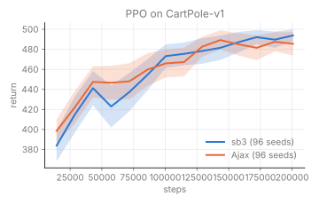
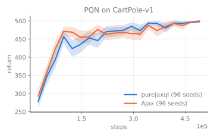

<h1 align="center">Ajax</h1>

<p align="center">
  <b>Fast, modular reinforcement learning in JAX.</b><br/>
  The environment, the agent and every seed run together in one program, on a CPU or a GPU, and agents are built from parts that snap together.
</p>

<p align="center">
  <a href="https://yannberthelot.github.io/Ajax/"></a>
  <a href="https://github.com/YannBerthelot/Ajax/actions/workflows/ci.yml"></a>
  <a href="https://pypi.org/project/ajax-rl/"></a>
  <a href="LICENSE"></a>
</p>

<p align="center">
  <a href="#install">Install</a> ·
  <a href="#quickstart">Quickstart</a> ·
  <a href="#agents">Agents</a> ·
  <a href="#learning-from-an-expert-or-from-data">Expert and data</a> ·
  <a href="#beside-reference-implementations">Reproduction</a> ·
  <a href="https://yannberthelot.github.io/Ajax/">Documentation</a>
</p>

Ajax has eighteen agents, each from a published paper. Compared with
[Stable-Baselines3](https://github.com/DLR-RM/stable-baselines3) and
[SBX](https://github.com/araffin/sbx), it offers:

- **[Fast and parallel](docs/guide/performance.md)**: the environment steps beside the agent on a CPU or a GPU, with no Python in the loop, so many seeds and environment copies train at once on one device. The benchmarks run on a CPU; GPU speed is not yet measured.
- **[Modular](docs/guide/extensions.md)**: GRU, LSTM, transformer and Mamba memories, CNN encoders, sequence replay with burn-in, a PID policy and thirty-three extensions, combined in the agent's constructor. The [compatibility table](docs/guide/compatibility.md) shows which parts go together.
- **Multi-paradigm**: discounted and average-reward agents ([ASAC](docs/algorithms/asac.md), [APO](docs/algorithms/apo.md)), model-free and model-based, online and offline, all behind one interface.
- **[Expert-guided](docs/guide/expert-guidance.md)**: cloning, imitation, prior data and offline training.
- **[World models, ready to use](docs/guide/world-models.md)**: DreamerV3 and TD-MPC2 are among the hardest agents to get right, and their papers run them on over a hundred tasks with one set of hyperparameters. Ajax checks them against the official code, update by update.

[Why Ajax](docs/getting-started/why-ajax.md) compares it with SB3, SBX,
PureJaxRL, Brax, Stoix, Rejax, TorchRL and Tianshou, including when to use
them instead.

## Install

```bash
pip install ajax-rl                 # imports as ajax; Python 3.12 or newer
pip install "ajax-rl[playground]"   # adds Brax and MuJoCo Playground environments
pip install "ajax-rl[cuda]"         # adds CUDA, on Linux with an NVIDIA GPU
```

`ajax-rl[brax]` adds Brax alone; [Installation](docs/getting-started/installation.md)
covers the other extras and `uv sync` from a clone.

## Quickstart

```python
from ajax import PPO
from ajax.logging import LoggingConfig

agent = PPO("CartPole-v1")  # 4 environments x 2048-step rollouts: one update per 8,192 steps
# Evaluate after every update; backends=() keeps the results in memory only.
logging = LoggingConfig(log_frequency=8_192, backends=())
state, evaluations = agent.train(seed=[1, 2, 3], n_timesteps=40_960, logging_config=logging)

print(evaluations["timestep"][0])                # when each evaluation ran
print(evaluations["Eval/episodic mean reward"])  # one row per seed, one column per evaluation
```

The three seeds train together, in about fifteen seconds on a laptop CPU,
compilation included. Parts combine in the constructor:

```python
from ajax import PPO, SAC
from ajax.extensions.instrumentation import ConditioningMetrics

# A recurrent actor and critic, for when one observation is not enough.
agent = SAC("Pendulum-v1", memory={"kind": "lstm", "hidden_size": 64})

# A research feature as an extension: the critic's health at each evaluation.
agent = PPO("CartPole-v1", extensions=(ConditioningMetrics(),))

# Brax and MuJoCo Playground environments by id (their extras), here 8 copies in parallel.
agent = PPO("ant", n_envs=8)
```

## Agents

- **Off-policy actor-critic**: [SAC](docs/algorithms/sac.md), [TD3](docs/algorithms/td3.md), [REDQ](docs/algorithms/redq.md), [CrossQ](docs/algorithms/crossq.md) (batch-renormalised, no target networks), [TQC](docs/algorithms/tqc.md) (truncated quantile critics), [AVG](docs/algorithms/avg.md) (no replay), [ASAC](docs/algorithms/asac.md) (average reward), [IQL](docs/algorithms/iql.md) (offline)
- **On-policy**: [PPO](docs/algorithms/ppo.md), [APO](docs/algorithms/apo.md) (average reward)
- **Value-based**: [DQN](docs/algorithms/dqn.md), [PQN](docs/algorithms/pqn.md)
- **World models**: [DreamerV3](docs/algorithms/dreamerv3.md), [TDMPC2](docs/algorithms/tdmpc2.md), [TDMPC2MultiTask](docs/algorithms/tdmpc2.md) (multi-task, offline)
- **Supervised**: [DAgger](docs/algorithms/dagger.md) (imitation of an expert), [UDRL](docs/algorithms/udrl.md) (command-conditioned)
- **Differentiable simulation**: [APG](docs/algorithms/apg.md)

DQN and PQN take discrete actions; PPO, APO, DAgger, UDRL and DreamerV3 take
both; the others continuous ones. SAC, TD3, REDQ, ASAC and DQN also train
offline (`train_offline`). Each name opens the agent's page, with its paper;
the [compatibility table](docs/guide/compatibility.md) lists every extension
per agent.

## Learning from an expert or from data

- **Before training**: behaviour cloning (`CloningPretrain`), expert transitions in the replay (`ExpertPrefill`), prior data as in RLPD (`PriorData`).
- **During training**: TD3+BC's actor term, kickstarting and Q-filtered cloning (`ImitationLoss`), IBRL (`IBRL`), residual RL (`ResidualPolicy`), JSRL hand-over (`JSRLCurriculum`), GAIL (`AdversarialReward`), and the `DAgger` agent.
- **Instead of online data**: `agent.train_offline(dataset, n_updates)`, then online fine-tuning if wanted: IQL, CQL and Cal-QL (`ConservativeQ`, `CalQL`), ReBRAC (`TargetBC`), TD3+BC; TD-MPC2's multi-task agent (`TDMPC2MultiTask`) on pooled datasets.

[Choosing the pieces](docs/guide/expert-guidance.md#choosing-the-pieces) gives
each method's paper and the agents that take it.

## Beside reference implementations

<p align="center">
  
  
</p>

Ajax's PPO beside Stable-Baselines3's and its PQN beside purejaxql's, on the
same JAX environment, 96 seeds each; both comparisons find the returns similar
within the registered margin. [Results](docs/reproduction/results.md) has two
more comparisons (one inconclusive) and the speed of each side; the
[protocol](docs/reproduction/protocol.md) says how they are run.

## Also in the box

<table>
<tr>
<td width="33%" valign="top"><a href="docs/guide/extensions.md"><b>Extensions</b></a><br/>Thirty-three research features, passed as <code>extensions=(...)</code></td>
<td width="33%" valign="top"><a href="docs/guide/memory.md"><b>Recurrent memory</b></a><br/>GRU, LSTM, transformer or Mamba, with sequence replay</td>
<td width="33%" valign="top"><a href="docs/guide/differentiable-simulation.md"><b>Differentiable simulation</b></a><br/>APG back-propagates the return through gymnax dynamics</td>
</tr>
<tr>
<td valign="top"><a href="docs/guide/environments.md"><b>Environments</b></a><br/>gymnax, Brax and MuJoCo Playground by id, many copies at once</td>
<td valign="top"><a href="docs/guide/networks.md"><b>Networks and the PID policy</b></a><br/>A CNN encoder; a PID controller as the actor</td>
<td valign="top"><a href="docs/guide/logging.md"><b>Logging</b></a><br/>Every evaluation as arrays; Weights &amp; Biases or TensorBoard</td>
</tr>
<tr>
<td valign="top"><a href="docs/guide/comparing-agents.md"><b>Comparing agents</b></a><br/>AdaStop, which adds seeds only while the answer is unclear</td>
<td valign="top"><a href="docs/guide/checkpoints.md"><b>Checkpoints</b></a><br/>Save a run and resume it in another process</td>
<td valign="top"><a href="docs/developer/testing.md"><b>Tests</b></a><br/>Unit tests, probes with known answers, conformance checks</td>
</tr>
</table>

The [documentation site](https://yannberthelot.github.io/Ajax/) has the user
guide, one page per agent, the [API reference](https://yannberthelot.github.io/Ajax/api/agents/)
and the [developer guide](docs/developer/architecture.md).

## Related projects

[gymnax](https://github.com/RobertTLange/gymnax),
[Brax](https://github.com/google/brax) and
[MuJoCo Playground](https://github.com/google-deepmind/mujoco_playground)
provide the environments, [flashbax](https://github.com/instadeepai/flashbax)
most replay buffers. [TargetGym](https://github.com/YannBerthelot/TargetGym)
has setpoint-tracking tasks with PID and MPC baselines, and
[ProbingEnvironments](https://github.com/YannBerthelot/ProbingEnvironments) the
small environments with known answers that Ajax's probes train on.

## Contributing, citing, license

Bug reports, new agents and new extensions are welcome; see
[CONTRIBUTING.md](CONTRIBUTING.md). Ajax is MIT-licensed ([LICENSE](LICENSE)).

```bibtex
@misc{ajax2025,
  title        = {Ajax: Reinforcement Learning Agents in Jax},
  author       = {Yann Berthelot},
  year         = {2025},
  url          = {https://github.com/YannBerthelot/Ajax},
}
```
