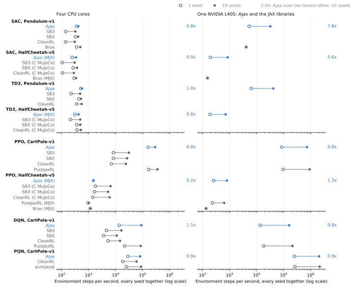
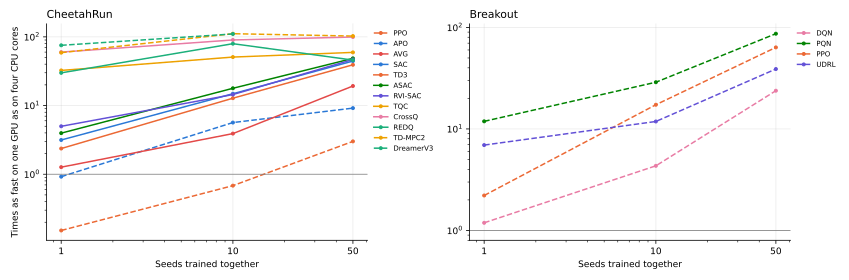

# Performance

A run's time splits into two parts: compiling the program, and running it.
For short runs and hyperparameter sweeps the first often dominates; for long
runs, the second. This page says what Ajax does about each and how to get
the most out of a machine. The numbers come from
[PERFORMANCE_REPORT.md](../../PERFORMANCE_REPORT.md), where every
measurement is described in full. They belong to the machine they were
measured on: use them for orders of magnitude, not as promises. They are
CPU measurements unless a line says otherwise.

## Against other libraries

The same algorithms, with the same settings, in Ajax and in
[Stable-Baselines3](https://github.com/DLR-RM/stable-baselines3),
[SBX](https://github.com/araffin/sbx), [CleanRL](https://github.com/vwxyzjn/cleanrl),
[PureJaxRL](https://github.com/luchris429/purejaxrl),
[Brax](https://github.com/google/brax) and
[purejaxql](https://github.com/mttga/purejaxql), each run its own documented
way: every library on the same four CPU cores, and Ajax and the JAX libraries
on one NVIDIA L40S.



<!-- speed-by-family:start -->
With 10 seeds on four CPU cores, against the fastest other library on each task, Ajax trains at:

- **SAC and TD3**: 0.8 times CleanRL's speed (TD3, HalfCheetah-v5) to 1.0 times CleanRL's speed (TD3, Pendulum-v1)
- **PPO**: 0.2 times SB3's speed (PPO, HalfCheetah-v5) to 0.8 times PureJaxRL's speed (PPO, CartPole-v1)
- **DQN and PQN**: 0.9 times purejaxql's speed (PQN, CartPole-v1) to 1.1 times PureJaxRL's speed (DQN, CartPole-v1)

With 10 seeds on one NVIDIA L40S, against the fastest JAX library on each task, Ajax trains at:

- **SAC**: 5.6 times Brax's speed (SAC, HalfCheetah-v5) to 7.8 times Brax's speed (SAC, Pendulum-v1)
- **PPO**: 0.8 times PureJaxRL's speed (PPO, CartPole-v1) to 1.3 times PureJaxRL's speed (PPO, HalfCheetah-v5)
- **DQN and PQN**: 0.8 times PureJaxRL's speed (DQN, CartPole-v1) to 0.9 times purejaxql's speed (PQN, CartPole-v1)

| Algorithm | Task | Seeds | Device | Ajax | Fastest other | Ajax's factor |
|---|---|---:|---|---:|---|---:|
| SAC | Pendulum-v1 | 1 | CPU | 358 | Brax, 355 | 1.01 |
| SAC | Pendulum-v1 | 10 | CPU | 414 | Brax, 493 | 0.84 |
| SAC | HalfCheetah-v5 | 1 | CPU | 245 | Brax, 289 | 0.85 |
| SAC | HalfCheetah-v5 | 10 | CPU | 339 | SBX, 374 | 0.91 |
| TD3 | Pendulum-v1 | 1 | CPU | 513 | SBX, 434 | 1.18 |
| TD3 | Pendulum-v1 | 10 | CPU | 573 | CleanRL, 552 | 1.04 |
| TD3 | HalfCheetah-v5 | 1 | CPU | 308 | CleanRL, 371 | 0.83 |
| TD3 | HalfCheetah-v5 | 10 | CPU | 423 | CleanRL, 517 | 0.82 |
| PPO | CartPole-v1 | 1 | CPU | 159,822 | PureJaxRL, 167,985 | 0.95 |
| PPO | CartPole-v1 | 10 | CPU | 288,583 | PureJaxRL, 352,323 | 0.82 |
| PPO | HalfCheetah-v5 | 1 | CPU | 1,502 | SB3, 1,767 | 0.85 |
| PPO | HalfCheetah-v5 | 10 | CPU | 1,509 | SB3, 6,521 | 0.23 |
| DQN | CartPole-v1 | 1 | CPU | 13,510 | PureJaxRL, 21,506 | 0.63 |
| DQN | CartPole-v1 | 10 | CPU | 89,198 | PureJaxRL, 84,333 | 1.06 |
| PQN | CartPole-v1 | 1 | CPU | 28,091 | purejaxql, 24,910 | 1.13 |
| PQN | CartPole-v1 | 10 | CPU | 80,609 | purejaxql, 86,759 | 0.93 |
| SAC | Pendulum-v1 | 1 | GPU | 5,246 | Brax, 4,101 | 1.28 |
| SAC | Pendulum-v1 | 10 | GPU | 32,167 | Brax, 4,101 (one after another) | 7.84 |
| SAC | HalfCheetah-v5 | 1 | GPU | 194 | Brax, 153 | 1.27 |
| SAC | HalfCheetah-v5 | 10 | GPU | 848 | Brax, 153 (one after another) | 5.55 |
| PPO | CartPole-v1 | 1 | GPU | 84,879 | PureJaxRL, 94,485 | 0.90 |
| PPO | CartPole-v1 | 10 | GPU | 727,466 | PureJaxRL, 911,309 | 0.80 |
| PPO | HalfCheetah-v5 | 1 | GPU | 255 | PureJaxRL, 231 | 1.10 |
| PPO | HalfCheetah-v5 | 10 | GPU | 792 | PureJaxRL, 630 | 1.26 |
| DQN | CartPole-v1 | 1 | GPU | 13,560 | PureJaxRL, 18,256 | 0.74 |
| DQN | CartPole-v1 | 10 | GPU | 159,158 | PureJaxRL, 210,896 | 0.75 |
| PQN | CartPole-v1 | 1 | GPU | 250,928 | purejaxql, 258,614 | 0.97 |
| PQN | CartPole-v1 | 10 | GPU | 2,034,588 | purejaxql, 2,162,308 | 0.94 |

Environment steps per second over every seed together, from a stretch of training once the updates run on four cores of an AMD EPYC 9454 48-Core Processor and one NVIDIA L40S ([records](https://github.com/YannBerthelot/Ajax/blob/main/benchmarks/speed/results/speed.jsonl)).
<!-- speed-by-family:end -->

- **Ten seeds**: Ajax, PureJaxRL and purejaxql train them in one program.
  SB3, SBX, CleanRL and Brax train one seed per process: ten processes at once
  on the four cores, or one after another where that is faster (the table says
  so), which runs at their one-seed speed. On the GPU, Brax's ten seeds would
  run one after another, so its one-seed speed stands for them.
- **HalfCheetah**: Ajax, Brax and PureJaxRL step gymnasium-mjx's
  HalfCheetah-v5 on MJX, MuJoCo in JAX. SB3, SBX and CleanRL step C MuJoCo
  through Gymnasium; CleanRL's scripts need Gymnasium 0.29, so they step
  HalfCheetah-v4, the same model.
- **What is timed**: environment steps per second over every seed, during a
  stretch of training once the updates run. Compilation, start-up and
  evaluations are left out. The machine is shared: each record notes how busy
  its cores were, and the same cell timed twice can differ by a tenth or more.

The settings, the same in every library where it takes them; they are
CleanRL's and PureJaxRL's defaults for PPO on CartPole and DQN, the defaults
SB3 and CleanRL share for SAC, TD3 and PPO on HalfCheetah, and purejaxql's for
PQN:

??? note "Settings"

    <!-- speed-settings:start -->
    | Setting | SAC | TD3 | PPO, CartPole-v1 | PPO, HalfCheetah-v5 | DQN | PQN |
    |---|---|---|---|---|---|---|
    | Environments per seed | 1 | 1 | 4 | 1 | 1 | 32 |
    | Rollout steps per environment |  |  | 128 | 2,048 |  | 64 |
    | Epochs per rollout |  |  | 4 | 10 |  | 4 |
    | Minibatches per epoch |  |  | 4 | 32 |  | 16 |
    | Batch size | 256 | 256 |  |  | 128 |  |
    | Replay buffer | 1,000,000 | 1,000,000 |  |  | 10,000 |  |
    | Updates per environment step | 1 | 1 |  |  |  |  |
    | Environment steps per update |  |  |  |  | 10 |  |
    | Environment steps per target copy |  |  |  |  | 500 |  |
    | Updates start after | 1,000 | 1,000 |  |  | 1,000 |  |
    | Hidden layers | 256-256 | 256-256 | 64-64 | 64-64 | 120-84 | 256-256 |
    | Activation | relu | relu | tanh | tanh | relu | relu |
    | Layer norm |  |  |  |  |  | yes |
    | Learning rate | 0.0003 | 0.0003 | 0.00025 | 0.0003 | 0.00025 | 0.0001 |
    | Discount | 0.99 | 0.99 | 0.99 | 0.99 | 0.99 | 0.99 |
    | Target smoothing | 0.005 | 0.005 |  |  |  |  |
    | Policy delay |  | 2 |  |  |  |  |
    | Target noise (clip) |  | 0.2 (0.5) |  |  |  |  |
    | Exploration noise |  | 0.1 |  |  |  |  |
    | Epsilon (final, decay share) |  |  |  |  | 1 to 0.05 (50%) | 1 to 0.2 (20%) |
    | GAE lambda |  |  | 0.95 | 0.95 |  |  |
    | Q(lambda) |  |  |  |  |  | 0.95 |
    | Clip range |  |  | 0.2 | 0.2 |  |  |
    | Entropy coefficient |  |  | 0.01 | 0 |  |  |
    | Gradient norm clip |  |  | 0.5 | 0.5 |  | 10 |
    | Observation and reward normalisation |  |  | no | yes |  |  |

    - CleanRL's PQN: 120-84 layers with layer norm (fixed in pqn.py).
    - PureJaxRL's PPO: 256-256 layers on HalfCheetah (fixed in ppo_continuous_action.py).
    - Brax's PPO: minibatches of whole 64-step unrolls, GAE within each, observations normalised but not rewards (Brax has no reward normaliser).
    <!-- speed-settings:end -->

[benchmarks/speed](https://github.com/YannBerthelot/Ajax/tree/main/benchmarks/speed)
has the method, each library's versions, the scripts and the records.

## The compile cache

`train` compiles the whole run, environment included. With logging, the
training between evaluations and the evaluation are separate programs. That
takes seconds to tens of seconds, and a fresh Python process would pay
it every time. So `import ajax` points JAX's persistent compile cache at
`~/.cache/ajax/jax_compile_cache`: a later process that compiles the same
program loads it from disk instead.

On the report's Plane3DCircle SAC scenario, run on a GPU, a second launch
of the same script took 3.35 s instead of 16.26 s, compile and warm-up fell from 21.5 s
to 4.9 s, and peak GPU memory fell from 302 MB to 15 MB, because the
compiler's scratch memory is never allocated.

What to know about it:

- **It serves relaunches, not new trials.** A rerun of the same script, or
  a repeated or resumed trial, loads its program from the cache. A new trial
  of a hyperparameter sweep is a different program: its hyperparameters are
  compiled in as constants, so it compiles from scratch. `train(sweep=...)`
  avoids this for the fields it covers
  ([Hyperparameter sweeps](training.md#hyperparameter-sweeps)). The budget, the
  agent's settings and the shapes are all part of the program.
- **A logged run is cached from JAX 0.11.** The [logging worker](logging.md)
  is fed by a host callback, and JAX 0.10 never stores a program that
  contains one, so on 0.10 a run with a `LoggingConfig` compiles in every
  new process.
- **One subdirectory per machine and version.** Entries are kept per CPU
  model, architecture, and Python, JAX and jaxlib versions, so environments
  with different versions, or machines sharing a home directory, do not
  load each other's programs.
- **Nothing trims it on its own.** Clear the directory yourself if it grows
  too large, or call `ajax._compile_cache.prune(root, max_bytes)`, which
  deletes the least recently used files until the rest fit (the repository's
  CI does this once per job).
- `AJAX_JAX_COMPILE_CACHE_DIR` moves the cache; `AJAX_NO_COMPILE_CACHE=1`
  turns it off.

## Seeds share one program

`train` runs all seeds as one vmapped program, so the fixed cost of
compiling and launching is paid once for all of them; running seeds in
separate calls pays it again for each. Until the device is busy, extra
seeds add little time. An early GPU measurement of SAC, from May 2026 on an
older version of Ajax, with small replay buffers and short runs
(`benchmarks/seed_scaling.jsonl`, `benchmarks/seed_scaling_p3d.jsonl`):

| Seeds | Pendulum, wall time | Plane3DCircle, wall time |
| --- | --- | --- |
| 1 | 9.81 s | 15.77 s |
| 4 | 10.51 s | 17.46 s |
| 16 | 10.43 s | 18.75 s |
| 32 | 11.08 s | 19.12 s |
| 100 | | 18.37 s |

Thirty-two seeds gave 28 times the throughput of one on Pendulum, and a
hundred seeds 86 times on Plane3DCircle. Each seed of a replay agent keeps
its own buffer, so memory grows with the number of seeds.

The scaling depends on the workload. In the report's scan of real
hyperparameter sweeps (wide networks, critic ensembles), going from 20 to 50
seeds made the time per seed and step worse for several method and
environment pairs, by up to 81%. Measure your own configuration before
settling on a seed count.

## Seeds over several devices

Once one device is busy, `train(devices=...)` splits the seeds (or a
sweep's configurations over the seeds) over several: each device trains a
consecutive slice of them at the same time, and the results come back in
the usual order, on the first device.

```python
import jax
from ajax import PPO

agent = PPO("Pendulum-v1", n_envs=2, n_steps=8)
state, out = agent.train(seed=range(4), n_timesteps=64, devices=jax.devices())
```

Each seed trains as it does on one device, but for rounding, which a long
run can amplify, as a change of the seed count does on one device. Each replay
buffer lives on the device that trains its seed, so the memory is split
too. A slice of another size is another program to compile: a number of
seeds the devices divide compiles once per device at most. One run is
never spread over devices: its environments and its updates stay on one.
A Gymnasium environment and an `evaluation_device` take no `devices`.

## bfloat16

`train(precision=...)` runs the networks' layers in bfloat16 (mixed
precision): the parameters, gradients and optimiser stay float32, each
layer computes in bfloat16 with its products summed in float32, and every
network returns float32, so the heads of the shared networks,
distributions, log-probabilities, losses, targets and normalisers stay
float32.

```python
from ajax import PPO

agent = PPO("Pendulum-v1", n_envs=2, n_steps=8)
state, out = agent.train(seed=0, n_timesteps=64, precision="auto")
print(agent.config["precision"])  # float32 on a CPU
```

- `"float32"`: as before. `None`, the default, is the agent's original
  code's precision: float32 for every agent. DreamerV3's original computes
  in bfloat16 (deviation D4 in the world-model deviations).
- `"bfloat16"`: bfloat16 even where the hardware has no bfloat16 units,
  with a warning: there XLA emulates it, no faster than float32 (about
  equal on an RTX 2080 Ti, slower on a CPU).
- `"auto"`: bfloat16 where every device of the run has bfloat16 units (an
  NVIDIA GPU of compute capability 8.0 or more, Ampere on, or a TPU), else
  float32: older GPUs and CPUs, so tests and CPU runs never change.

The run config records what the run computed in (`precision`). The
parameters are float32 either way, so a run may resume in another
precision. bfloat16 changes the numbers: it keeps about three significant
digits.

What reaches bfloat16: the shared networks' observation encoders (the
hidden layers before any memory; image encoders and memory cells stay
float32), PQN's and APG's hidden layers, TD-MPC2's world model and policy
prior, and DreamerV3's model, recurrent state and stored latents (half the
replay, without loss). On bob's L40S (2026-11-20, float32 and bfloat16
alternating in one process, HalfCheetah on MuJoCo Warp), environment steps
per second were 1.51x for DreamerV3 (4 seeds), 1.18x for TD-MPC2 and 1.03x
for SAC, and 0.93x for PPO, whose 64-wide layers are too small to gain:
the gain follows the size of the networks and batches.

## Parallel environments

`n_envs` copies of the environment step together inside each seed, as one
vectorised operation. Unlike seeds, they change the algorithm: an
off-policy agent makes one update per iteration, so more copies at a fixed
budget mean fewer updates ([Training](training.md)). Pick `n_envs` for the
learning you want, then use seeds to fill the device.

## CPU or GPU

On four CPU cores and on one GPU, on CheetahRun (top) and Breakout-MinAtar
(below):

<!-- agent-timing:start -->
| Agent | Task | Four CPU cores | One NVIDIA L40S | Gain | Compile s, CPU / GPU |
|---|---|---:|---:|---:|---:|
| SAC | CheetahRun | 41 | 608 | 15 times | 19 / 36 |
| TD3 | CheetahRun | 51 | 656 | 13 times | 17 / 36 |
| ASAC | CheetahRun | 34 | 615 | 18 times | 28 / 36 |
| RVI-SAC | CheetahRun | 42 | 603 | 14 times | 21 / 38 |
| AVG | CheetahRun | 171 | 670 | 3.9 times | 20 / 32 |
| APO | CheetahRun | 1,066 | 6,026 | 5.7 times | 29 / 35 |
| PPO | CheetahRun | 1,269 | 866 | 0.68 times | 29 / 34 |
| REDQ | CheetahRun | 0.71 | 56 | 80 times | 26 / 40 |
| TQC | CheetahRun | 3.1 | 157 | 51 times | 20 / 39 |
| CrossQ | CheetahRun | 0.98 | 88 | 90 times | 21 / 38 |
| DreamerV3 | CheetahRun | 0.064 | 7.1 | 110 times | 51 / 169 |
| TD-MPC2 | CheetahRun | 0.3 | 34 | 111 times | 34 / 105 |
| DQN | Breakout | 2,926 | 12,678 | 4.3 times | 4 / 8 |
| PQN | Breakout | 14,045 | 405,168 | 29 times | 3 / 7 |
| PPO | Breakout | 4,622 | 80,044 | 17 times | 5 / 10 |
| UDRL | Breakout | 545 | 6,455 | 12 times | 5 / 8 |

Environment steps per second per seed, higher is faster, with 10 seeds trained together: the run makes 10 times as many in all. Each is timed on a segment of training once the agent's updates run, without evaluations; the compile seconds are those of the run's first call. The CPU column ran on four cores of an AMD EPYC 9454 48-Core Processor, the GPU column on one NVIDIA L40S of the same machine, at commits `7687a4d` and `7bc8b3c` ([records](https://github.com/YannBerthelot/Ajax/tree/main/benchmarks/suite/results/timing-0.6)).
<!-- agent-timing:end -->

Each agent has the [benchmark's](../reproduction/benchmark.md) settings, with
MJX's pure-JAX physics on CheetahRun, except that the off-policy agents
started their updates by step 256 in these runs, so that the timed segment
trains throughout. The benchmark's
[score against time](../reproduction/benchmark.md#at-a-glance) turns these
speeds into hours.

A GPU gains most where updates take the time: many critics, wide networks
and world models (REDQ, TQC, CrossQ, DreamerV3, TD-MPC2) train about 50 to
110 times as fast on the L40S. It gains little on one simulator step per seed:
AVG, APO and DQN gain 4 to 6 times, and PPO on CheetahRun runs faster on the
four CPU cores.

How the gain changes with the number of seeds trained together, on the
same tasks and machines. DreamerV3 stops at 10 seeds: at 50, its replay would
need about 500 GB of memory.



<!-- agent-gain-by-seeds:start -->
<!-- agent-gain-by-seeds:end -->

More seeds help until the card is full. SAC's total levelled off near 8,000
steps per second from 64 seeds, while PPO reached 42,000 at 256. Three SAC jobs
at once on an otherwise idle card gave 1.9 times the throughput of one.
`benchmarks/gpu_check.sh` compares four agents on CartPole and Pendulum with
the same machine's CPU, in `benchmarks/gpu/report.md`.

The logging worker always runs on the CPU, so it never takes GPU memory.
Playground runs MJX's pure-JAX physics on every device by default. On a GPU,
MuJoCo Warp (`physics="warp"`, see [Environments](environments.md)) trained
about five times faster on an L40S, with 10 seeds of one environment each:

| Agent, task | Pure JAX | Pure JAX, command buffers | Warp |
|---|---:|---:|---:|
| SAC, `mujoco:Hopper-v5` | 28 | 38 | 181 |
| PPO, `mujoco:HalfCheetah-v5` | 84 | 102 | 569 |

These are steps per second per seed, from timing runs without evaluations.
With 100 seeds, SAC on Warp ran 80 steps per second per seed, 8,000 in all.
The command buffers are `XLA_FLAGS="--xla_gpu_enable_command_buffer=FUSION,CUBLAS,CUBLASLT,CUSTOM_CALL,CUDNN,WHILE,CONDITIONAL --xla_gpu_graph_min_graph_size=1 --xla_gpu_command_buffer_unroll_loops=true"`;
without the last flag they gave pure JAX 32 and 85.
Leave command buffers off with Warp: without the last flag they slowed its
PPO run to 173 steps per second per seed, with or without `CUSTOM_CALL`.

A GPU doesn't promise the same result twice by default: two identical PPO runs
on HumanoidWalk differed. `XLA_FLAGS=--xla_gpu_deterministic_ops=true` made
repeated and resumed runs match exactly on CheetahRun and HumanoidWalk. At 10
seeds it cost 11% of speed on TQC and 33% on APO on HumanoidWalk. gymnax tasks
matched without it.

To keep a run on the CPU of a machine with a GPU, set `JAX_PLATFORMS=cpu`
(and `CUDA_VISIBLE_DEVICES=""` to hide the GPU entirely). The repository's
tests and benchmarks run this way, so they never compete with an experiment
on the GPU.

## Logging

Evaluation runs `num_episode_test` whole episodes every `log_frequency`
steps, on top of training: evaluate as often as your curves need, not more.
Without a `LoggingConfig` the evaluation is not compiled at all, and the
program can be cached.

## Agent speeds

`benchmarks/agent_bench.py` times every agent on a fixed task (CartPole for
DQN, PQN, PPO and DreamerV3, a Pendulum tracking task for APG, Pendulum for
the others, DAgger imitating a PD controller), 4 environment copies, 8,000
steps, one seed, 5 trials, the compile cache off, on a Mac's CPU. Every
agent updates within the run: the replay agents start at step 1,000 instead
of their defaults (10,000 for SAC, TD3, REDQ and ASAC). Medians of the five
trials, from the baseline recorded on 2026-10-28 (PQN's on 2026-11-03, once
it stopped training a rollout past its budget):

| Agent | Steps per second, execution | Steps per second, whole run | Compile and warm-up (s) |
| --- | --- | --- | --- |
| DAgger | 42,406 | 9,508 | 0.8 |
| PQN | 37,683 | 8,973 | 0.9 |
| APO | 31,243 | 7,203 | 1.2 |
| APG | 28,105 | 6,385 | 1.3 |
| PPO | 25,391 | 6,698 | 1.3 |
| UDRL | 21,876 | 6,419 | 1.1 |
| DQN | 21,542 | 8,256 | 0.8 |
| AVG | 11,560 | 5,366 | 1.1 |
| TD3 | 4,063 | 2,911 | 1.2 |
| IQL | 3,145 | 2,319 | 1.1 |
| SAC | 3,094 | 2,302 | 4.6 |
| ASAC | 2,135 | 1,709 | 1.2 |
| DreamerV3 | 508 | 407 | 7.6 |
| TDMPC2 | 412 | 360 | 4.5 |
| TQC | 392 | 374 | 1.3 |
| CrossQ | 91 | 90 | 1.7 |
| REDQ | 63 | 63 | 1.2 |

"Execution" leaves out the time JAX spends tracing, lowering and compiling
the program; "whole run" includes it, because every trial builds a fresh
agent, whose program is traced again. REDQ is slow by design: from step
1,000 it makes 20 updates of 10 critics per environment step. CrossQ's
critics are 2,048 units wide, and TQC updates 5 critics of three 512-unit
layers. ASAC's and IQL's trials spread the most. DreamerV3 and TD-MPC2 run at reduced presets (DreamerV3's
smallest size, `"1m"`; a TD-MPC2 narrowed to 64-unit layers and a smaller
planner); at its paper's defaults TD-MPC2 would take minutes per bench run
on a CPU, since it updates its model and plans at every environment step.
Speeds on your machine will differ; the ratios between agents are the
useful part. [Developer performance](../developer/performance.md) explains
how to run the benchmark and the 10% no-regression rule every change
follows.

## Other measured costs

- **The action map.** Mapping every continuous action onto the
  environment's bounds ([Actions](environments.md#actions)) cost nothing
  measurable: SAC +0.1%, TD3 +2.8% and PPO +1.0% steps per second, within
  noise.
- **Playground fresh resets.** Drawing a new initial state per episode
  (the default) costs a reset per episode. On CheetahRun, whose reset runs a
  200-step stabilisation, SAC's iterations took about 2% longer, and compile
  plus first run grew from 36 s to 59 s per cold process.
- **Brax resets.** Ajax's Brax wrapper computes a reset only on steps where
  some copy's episode ended. `differentiable_reset=True` computes one every
  step, which cost about 7-13% of a step's time in the report's
  measurement.
- **Memory blocks** in the replay agents: see [Memory](memory.md).
