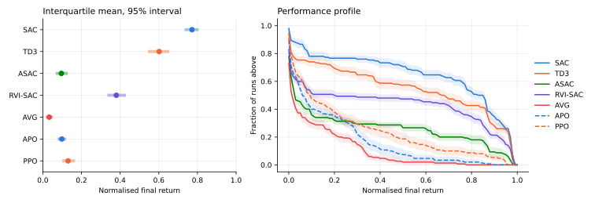
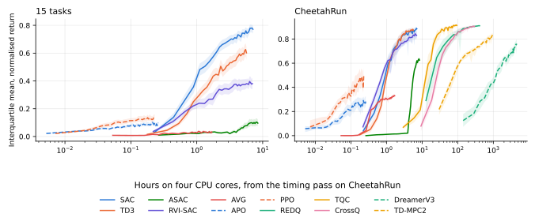
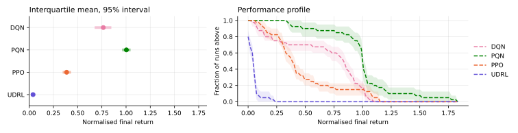
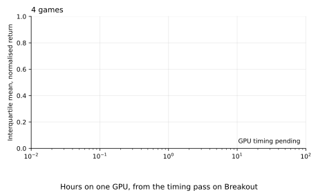
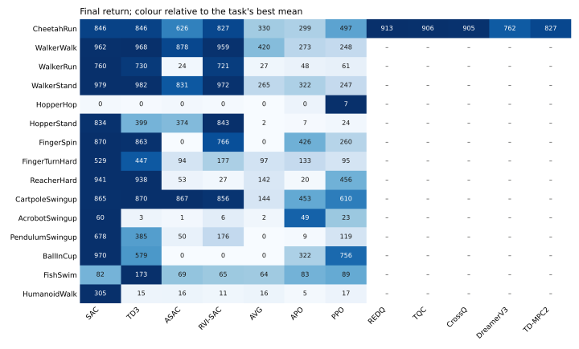
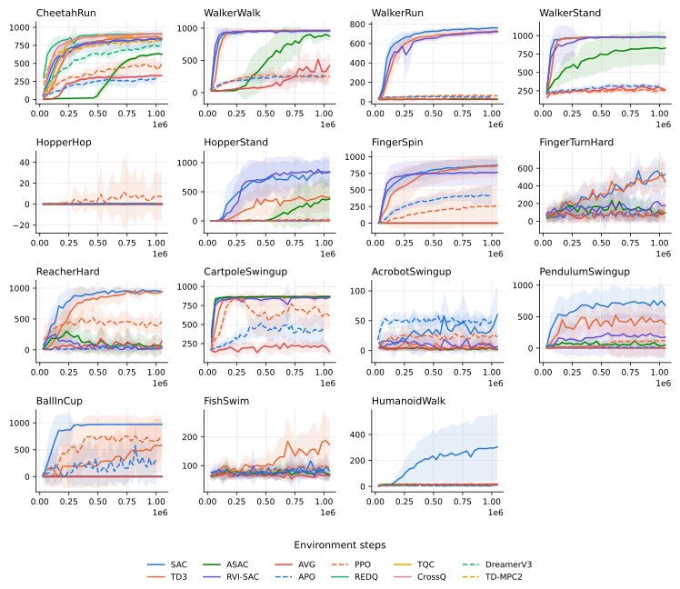
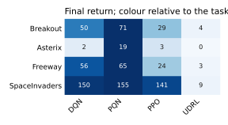
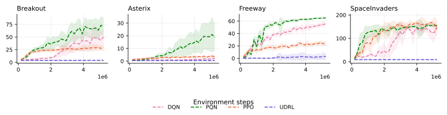

# Agent benchmark

Every agent at its default settings, with 10 seeds each, apart from `n_envs`,
which follows each agent's paper. DreamerV3 also keeps its replay in host
memory (`replay_on_host=True`), which gives the same numbers with less GPU
memory. PPO, APO, DQN, PQN and REDQ were rerun from 2026-11-14 at the defaults
they have had since 2026-11-13; the other agents' rows
are from the earlier commits named below. How Ajax's agents
compare with other implementations is in the [results](results.md).

## At a glance

These figures put each suite on one scale, as
[rliable](https://github.com/google-research/rliable) does (Agarwal et al.,
[Deep RL at the Edge of the Statistical Precipice](https://arxiv.org/abs/2108.13264),
NeurIPS 2021): DeepMind Control returns are divided by 1000, their maximum,
and MinAtar returns by the game's best mean in the tables below. A run is one
task and one seed; a suite's aggregates hold the agents that ran all its
tasks. `benchmarks/suite/publish.py` draws them from the records.

=== "DeepMind Control"

    

    

=== "MinAtar"

    

    

In the first figure, the dot is the interquartile mean of an agent's final
returns, the mean of the middle half of its runs, which a few outlying runs
move little, and the bar is its 95% interval, from resampling the seeds of
each task. On the right, each line gives the fraction of runs that ended
above each score: a line that stays high further to the right did well on
more of its runs.

The second figure follows the interquartile mean through training against the
hours four CPU cores take to reach each evaluation, at the speed the
[timing pass](../guide/performance.md#cpu-or-gpu) measured rather than each
run's own wall clock, since the runs used several machines. Its CheetahRun
panel adds the five agents that ran that task only.

## Setup

- **Tasks.** Fifteen DeepMind Control tasks on MuJoCo Playground, trained for
  1,048,576 steps (APO 1,000,000, a whole number of its rollouts), and four
  MinAtar games on gymnax, trained for 5,242,880 steps.
- **Machines.** Seeds 0 to 9 trained together. Most of the earlier cells
  ran on 4-core cloud CPUs, and the PPO, APO, DQN and PQN reruns on 4 cores
  each of a shared 192-core machine (REDQ's rerun on the GPU below). The cells added later ran on one shared NVIDIA L40S GPU: SAC,
  TD3, RVI-SAC and ASAC on the twelve tasks beyond CheetahRun, WalkerWalk and
  HopperHop, APO on HumanoidWalk, and the five agents in the second table.
  The physics is MJX's pure-JAX version on both. DQN on Freeway and
  SpaceInvaders ran in two halves, for memory, before its rerun, and
  DreamerV3 one seed at a time.
- **Code.** PPO, APO, DQN, PQN and REDQ: the main branch at `2ef57fe`. The other
  agents: the main branch at `acd1626`, after 0.5.0, for the CPU cells, and
  at `e7647bc` for the GPU cells. TD-MPC2 moved to `eeb029d` after its first
  32,768 steps, which only changed how often it evaluates.
- **Score.** The return at the last evaluation, as mean ± standard deviation
  over the seeds (a sample standard deviation), with the best mean in each
  row in bold. With 10 seeds, a
  small gap between two agents means little. DeepMind Control scores run from
  0 to 1000.
- **Records.** [`benchmarks/suite`](https://github.com/YannBerthelot/Ajax/tree/main/benchmarks/suite)
  holds the driver and each run's records. The records of PPO, APO, DQN,
  PQN and REDQ at their earlier defaults are in each run's `earlier-defaults`
  folder.

## Results

Each tab has the final returns, as a table and as a heatmap that scales each
task to its best mean, then the learning curves: the mean over seeds with a
band of one standard deviation. `benchmarks/suite/publish.py` writes them
from the records.

<!-- benchmark-tables:start -->
=== "DeepMind Control"

    | Task | SAC | TD3 | ASAC | RVI-SAC | AVG | APO | PPO |
    |---|---|---|---|---|---|---|---|
    | CheetahRun | 846.1 ± 127.2 | **846.5 ± 87.3** | 625.9 ± 21.5 | 827.4 ± 42.7 | 330.1 ± 9.5 | 298.8 ± 65.9 | 497.2 ± 99.5 |
    | WalkerWalk | 961.8 ± 28.2 | **967.5 ± 4.0** | 877.9 ± 77.6 | 959.3 ± 26.0 | 420.2 ± 203.8 | 272.5 ± 112.5 | 248.0 ± 121.1 |
    | WalkerRun | **760.4 ± 25.1** | 730.2 ± 39.5 | 23.6 ± 1.4 | 720.8 ± 25.9 | 27.5 ± 5.5 | 48.1 ± 3.5 | 60.5 ± 14.2 |
    | WalkerStand | 979.0 ± 17.8 | **981.6 ± 3.6** | 830.5 ± 232.5 | 972.2 ± 21.3 | 264.8 ± 46.6 | 321.8 ± 34.0 | 246.8 ± 35.6 |
    | HopperHop | 0.2 ± 0.3 | 0.1 ± 0.1 | 0.2 ± 0.3 | 0.1 ± 0.3 | 0.0 ± 0.0 | 0.4 ± 0.7 | **7.5 ± 22.1** |
    | HopperStand | 833.8 ± 209.1 | 399.1 ± 239.2 | 373.8 ± 394.6 | **843.5 ± 291.2** | 2.2 ± 2.1 | 7.4 ± 7.2 | 23.5 ± 49.2 |
    | FingerSpin | **870.5 ± 109.1** | 863.2 ± 166.5 | 0.1 ± 0.3 | 765.5 ± 193.0 | 0.1 ± 0.2 | 425.9 ± 144.0 | 259.8 ± 329.1 |
    | FingerTurnHard | **529.5 ± 143.9** | 446.5 ± 181.2 | 93.8 ± 78.7 | 176.8 ± 169.9 | 97.5 ± 103.8 | 133.0 ± 91.0 | 94.5 ± 129.3 |
    | ReacherHard | **941.4 ± 69.7** | 938.3 ± 42.8 | 53.1 ± 118.7 | 26.7 ± 39.4 | 141.9 ± 250.4 | 19.7 ± 28.0 | 456.3 ± 210.2 |
    | CartpoleSwingup | 864.5 ± 1.7 | **870.2 ± 7.5** | 867.4 ± 9.9 | 855.5 ± 13.6 | 144.0 ± 52.7 | 452.6 ± 181.6 | 610.5 ± 202.6 |
    | AcrobotSwingup | **60.1 ± 51.1** | 2.8 ± 4.0 | 1.4 ± 1.3 | 6.3 ± 8.6 | 2.1 ± 2.1 | 48.6 ± 13.8 | 22.8 ± 8.1 |
    | PendulumSwingup | **678.2 ± 276.8** | 384.9 ± 266.3 | 49.6 ± 96.4 | 176.2 ± 346.5 | 0.3 ± 0.7 | 9.2 ± 15.6 | 118.9 ± 249.0 |
    | BallInCup | **970.4 ± 3.1** | 579.0 ± 498.3 | 0.0 ± 0.0 | 0.0 ± 0.0 | 0.0 ± 0.0 | 321.9 ± 421.0 | 755.5 ± 398.4 |
    | FishSwim | 82.0 ± 27.6 | **173.0 ± 79.1** | 69.4 ± 22.2 | 65.3 ± 9.9 | 64.0 ± 17.3 | 82.7 ± 13.0 | 89.4 ± 12.6 |
    | HumanoidWalk | **304.5 ± 257.8** | 14.5 ± 13.6 | 16.1 ± 1.2 | 11.4 ± 10.2 | 15.8 ± 4.8 | 5.1 ± 3.0 | 16.8 ± 4.5 |

    The agents that ran under half of these tasks:

    | Task | REDQ | TQC | CrossQ | DreamerV3 | TD-MPC2 |
    |---|---|---|---|---|---|
    | CheetahRun | **909.4 ± 7.6** | 906.3 ± 27.2 | 905.2 ± 10.7 | 761.7 ± 56.9 | 827.5 ± 32.0 |

    

    

=== "MinAtar"

    | Game | DQN | PQN | PPO | UDRL |
    |---|---|---|---|---|
    | Breakout | 50.3 ± 17.9 | **70.7 ± 18.0** | 28.8 ± 6.5 | 4.0 ± 1.3 |
    | Asterix | 2.1 ± 1.2 | **18.7 ± 11.1** | 3.4 ± 1.6 | 0.4 ± 0.3 |
    | Freeway | 55.8 ± 3.0 | **65.1 ± 0.7** | 24.1 ± 4.0 | 2.7 ± 5.7 |
    | SpaceInvaders | 150.1 ± 14.9 | **154.7 ± 5.7** | 141.0 ± 38.4 | 8.9 ± 2.0 |

    

    
<!-- benchmark-tables:end -->

## Reading the tables

- **The simulator diverged on HumanoidWalk** on some training steps of SAC
  (173), TD3 (474), RVI-SAC (37), PPO (4) and APO (2), out of about 10
  million steps per agent. The guard against non-finite values handled them
  and the runs went on.
- **One run is a second attempt, from step 0.** AVG's first attempt on
  HopperStand was cut off by a machine restart.
- **No agent learned HopperHop** at this budget. PPO's mean of 7.5 comes
  from one seed that ended at 70; every other mean is below 1, so its
  heatmap colours compare noise.
- **The last evaluation can swing.** On BallInCup, 8 of PPO's seeds ended above
  910 and 2 at 0, and 4 of APO's ended above 630 and 6 at 0.
- **Hopper and Finger runs turned an XLA pass off**, as
  [Environments](../guide/environments.md#brax-and-playground) explains.
- **GPU runs used deterministic operations**, so a run repeats exactly,
  except the twelve SAC, TD3, RVI-SAC and ASAC cells on HopperStand,
  FingerSpin and FingerTurnHard, where XLA fails to compile them together
  with that pass turned off.

## What the new defaults changed

PPO, APO, DQN and PQN took their reference implementations' defaults on
2026-11-13. Final returns before and after, on the same tasks and seeds
(APO ran 1,024,000 steps before). With 10 seeds, only the larger gaps mean
much.

- **PPO on DeepMind Control** rose on CheetahRun (215 to 497), ReacherHard
  (38 to 456) and HumanoidWalk (6 to 17), and fell on PendulumSwingup (408
  to 119). The other tasks moved less; the largest of those gaps is
  WalkerRun's (74 to 61).
- **PPO on MinAtar** fell on Freeway (41.7 to 24.1) and Asterix (5.8 to
  3.4), and stayed level on Breakout and SpaceInvaders.
- **APO** rose on CheetahRun (213 to 299), FingerSpin (231 to 426),
  WalkerStand (270 to 322) and BallInCup (0 to 322), and fell on
  CartpoleSwingup (769 to 453), HumanoidWalk (14 to 5) and PendulumSwingup
  (31 to 9).
- **DQN** fell on Breakout (83.6 to 50.3) and moved little on the other
  three games.
- **PQN** rose on all four games: Breakout 23.8 to 70.7, Asterix 4.1 to
  18.7, Freeway 23.4 to 65.1 and SpaceInvaders 137.6 to 154.7.
- **REDQ**, whose warm-up went from 10,000 to 5,000 steps, did
  not move on CheetahRun: 912.9 ± 5.6 before, 909.4 ± 7.6 after.

## Agents not in the tables

APG needs a differentiable task, IQL a dataset and DAgger an expert to query,
and TD-MPC2's multi-task agent trains on a suite of tasks.
