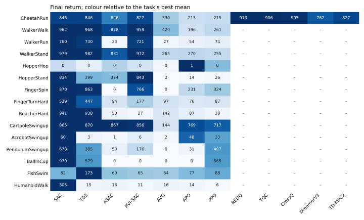
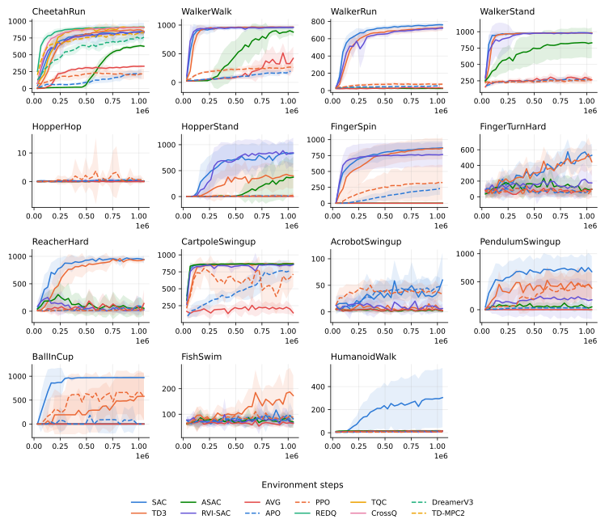
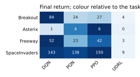
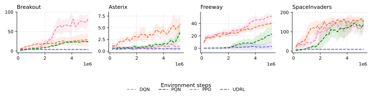

# Agent benchmark

Every agent at its default settings, with 10 seeds each, apart from `n_envs`,
which follows each agent's paper. How Ajax's agents
compare with other implementations is in the [results](results.md).

## Setup

- **Tasks.** Fifteen DeepMind Control tasks on MuJoCo Playground, trained for
  1,048,576 steps (APO 1,024,000, a whole number of its rollouts), and four
  MinAtar games on gymnax, trained for 5,242,880 steps.
- **Machines.** Seeds 0 to 9 trained together. Most cells ran on 4-core
  cloud CPUs. The cells added later ran on one shared NVIDIA L40S GPU: SAC,
  TD3, RVI-SAC and ASAC on the twelve tasks beyond CheetahRun, WalkerWalk and
  HopperHop, APO on HumanoidWalk, and the five agents in the second table.
  The physics is MJX's pure-JAX version on both. DQN on Freeway and
  SpaceInvaders ran in two halves, for memory, and DreamerV3 one seed at a
  time.
- **Code.** The main branch at `acd1626`, after 0.5.0, for the CPU cells, and
  at `e7647bc` for the GPU cells. TD-MPC2 moved to `eeb029d` after its first
  32,768 steps, which only changed how often it evaluates.
- **Score.** The return at the last evaluation, as mean ± standard deviation
  over the seeds (a sample standard deviation), with the best mean in each
  row in bold. With 10 seeds, a
  small gap between two agents means little. DeepMind Control scores run from
  0 to 1000.
- **Records.** [`benchmarks/suite`](https://github.com/YannBerthelot/Ajax/tree/main/benchmarks/suite)
  holds the driver and each run's records.

## Results

Each tab has the final returns, as a table and as a heatmap that scales each
task to its best mean, then the learning curves: the mean over seeds with a
band of one standard deviation. `benchmarks/suite/publish.py` writes them
from the records.

<!-- benchmark-tables:start -->
=== "DeepMind Control"

    | Task | SAC | TD3 | ASAC | RVI-SAC | AVG | APO | PPO |
    |---|---|---|---|---|---|---|---|
    | CheetahRun | 846.1 ± 127.2 | **846.5 ± 87.3** | 625.9 ± 21.5 | 827.4 ± 42.7 | 330.1 ± 9.5 | 212.7 ± 67.6 | 214.9 ± 74.0 |
    | WalkerWalk | 961.8 ± 28.2 | **967.5 ± 4.0** | 877.9 ± 77.6 | 959.3 ± 26.0 | 420.2 ± 203.8 | 196.1 ± 43.9 | 260.6 ± 76.4 |
    | WalkerRun | **760.4 ± 25.1** | 730.2 ± 39.5 | 23.6 ± 1.4 | 720.8 ± 25.9 | 27.5 ± 5.5 | 53.9 ± 7.0 | 74.0 ± 14.7 |
    | WalkerStand | 979.0 ± 17.8 | **981.6 ± 3.6** | 830.5 ± 232.5 | 972.2 ± 21.3 | 264.8 ± 46.6 | 270.1 ± 39.3 | 254.6 ± 54.2 |
    | HopperHop | 0.2 ± 0.3 | 0.1 ± 0.1 | 0.2 ± 0.3 | 0.1 ± 0.3 | 0.0 ± 0.0 | **0.6 ± 0.9** | 0.3 ± 0.5 |
    | HopperStand | 833.8 ± 209.1 | 399.1 ± 239.2 | 373.8 ± 394.6 | **843.5 ± 291.2** | 2.2 ± 2.1 | 13.6 ± 20.7 | 25.9 ± 55.3 |
    | FingerSpin | **870.5 ± 109.1** | 863.2 ± 166.5 | 0.1 ± 0.3 | 765.5 ± 193.0 | 0.1 ± 0.2 | 231.1 ± 98.6 | 324.2 ± 275.6 |
    | FingerTurnHard | **529.5 ± 143.9** | 446.5 ± 181.2 | 93.8 ± 78.7 | 176.8 ± 169.9 | 97.5 ± 103.8 | 75.7 ± 62.0 | 86.6 ± 32.0 |
    | ReacherHard | **941.4 ± 69.7** | 938.3 ± 42.8 | 53.1 ± 118.7 | 26.7 ± 39.4 | 141.9 ± 250.4 | 87.5 ± 154.9 | 38.2 ± 55.2 |
    | CartpoleSwingup | 864.5 ± 1.7 | **870.2 ± 7.5** | 867.4 ± 9.9 | 855.5 ± 13.6 | 144.0 ± 52.7 | 769.2 ± 146.0 | 716.7 ± 183.7 |
    | AcrobotSwingup | **60.1 ± 51.1** | 2.8 ± 4.0 | 1.4 ± 1.3 | 6.3 ± 8.6 | 2.1 ± 2.1 | 48.0 ± 16.4 | 33.3 ± 15.2 |
    | PendulumSwingup | **678.2 ± 276.8** | 384.9 ± 266.3 | 49.6 ± 96.4 | 176.2 ± 346.5 | 0.3 ± 0.7 | 31.0 ± 24.2 | 407.5 ± 241.2 |
    | BallInCup | **970.4 ± 3.1** | 579.0 ± 498.3 | 0.0 ± 0.0 | 0.0 ± 0.0 | 0.0 ± 0.0 | 0.0 ± 0.0 | 565.1 ± 486.8 |
    | FishSwim | 82.0 ± 27.6 | **173.0 ± 79.1** | 69.4 ± 22.2 | 65.3 ± 9.9 | 64.0 ± 17.3 | 76.9 ± 11.9 | 88.0 ± 31.8 |
    | HumanoidWalk | **304.5 ± 257.8** | 14.5 ± 13.6 | 16.1 ± 1.2 | 11.4 ± 10.2 | 15.8 ± 4.8 | 13.8 ± 2.9 | 6.4 ± 3.3 |

    The agents that ran under half of these tasks:

    | Task | REDQ | TQC | CrossQ | DreamerV3 | TD-MPC2 |
    |---|---|---|---|---|---|
    | CheetahRun | **912.9 ± 5.6** | 906.3 ± 27.2 | 905.2 ± 10.7 | 761.7 ± 56.9 | 827.5 ± 32.0 |

    

    

=== "MinAtar"

    | Game | DQN | PQN | PPO | UDRL |
    |---|---|---|---|---|
    | Breakout | **83.6 ± 12.3** | 23.8 ± 1.8 | 27.1 ± 14.0 | 4.0 ± 1.3 |
    | Asterix | 1.0 ± 0.6 | 4.1 ± 2.0 | **5.8 ± 2.0** | 0.4 ± 0.3 |
    | Freeway | **51.9 ± 4.0** | 23.4 ± 14.1 | 41.7 ± 4.7 | 2.7 ± 5.7 |
    | SpaceInvaders | 143.1 ± 20.3 | 137.6 ± 26.3 | **149.9 ± 34.2** | 8.9 ± 2.0 |

    

    
<!-- benchmark-tables:end -->

## Reading the tables

- **APO on HumanoidWalk was rerun on the GPU.** The CPU run stopped at step
  81,920 of 1,024,000 when a chunk hit non-finite values twice. The rerun
  finished, with no non-finite step.
- **The simulator diverged on HumanoidWalk** on some training steps of SAC
  (173), TD3 (474) and RVI-SAC (37), out of over 10 million steps per agent.
  The guard against non-finite values handled them and the runs went on.
- **Two runs are second attempts, from step 0.** PPO's first attempt on
  HumanoidWalk also hit non-finite values, past step 327,680, and AVG's on
  HopperStand was cut off by a machine restart.
- **No agent learned HopperHop** at this budget. Its best mean is below 1,
  so its heatmap colours compare noise.
- **The last evaluation can swing.** On BallInCup, 6 of PPO's seeds ended above
  890 and 4 at 0, and APO ended at 0 after scoring higher earlier.
- **Hopper and Finger runs turned an XLA pass off**, as
  [Environments](../guide/environments.md#brax-and-playground) explains.
- **GPU runs used deterministic operations**, so a run repeats exactly,
  except the twelve SAC, TD3, RVI-SAC and ASAC cells on HopperStand,
  FingerSpin and FingerTurnHard, where XLA fails to compile them together
  with that pass turned off.

## Agents not in the tables

APG needs a differentiable task, IQL a dataset and DAgger an expert to query,
and TD-MPC2's multi-task agent trains on a suite of tasks.
