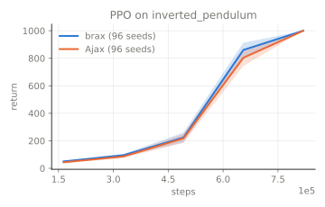
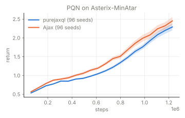

# Results

Written by `benchmarks/reference/refcmp_publish.py docs` from the
records the dataset publishes. Ajax is its matched arm. The
difference is Ajax's mean final return minus the reference's, with
its 95% bootstrap interval; the verdict sets that interval against the
registered margin. AdaStop names the difference it detected, and the
resolution is the smallest gap its budget detects 80% of the time.
Speed is measured on the CPU, medians over batches.

| Comparison | Verdict | Margin | Seeds | Reference | Ajax | Difference | AdaStop | Resolution |
|---|---|---|---|---|---|---|---|---|
| PPO | similar | ±25.0 | 96 | 493.8 | 485.5 | -8.4 [-22.0, +3.7] | none shown | 12.0 |
| PPO-inverted_pendulum | similar | ±50.0 | 96 | 1000.0 | 1000.0 | +0.0 [+0.0, +0.0] | none shown | 0.0 |
| PQN | similar | ±25.0 | 96 | 498.0 | 499.9 | +1.9 [-0.1, +4.7] | none shown | 0.0 |
| PQN-Asterix | inconclusive | ±0.1 | 96 | 2.3 | 2.5 | +0.2 [+0.0, +0.3] | none shown | 0.2 |

## Speed

| Comparison | Side | Steps per second | CPU seconds per 1M steps | Compile seconds |
|---|---|---|---|---|
| PPO | sb3 | 9,807 | 395 | 3.5 |
| PPO | Ajax | 25,087 | 63 | 7.8 |
| PPO-inverted_pendulum | brax | 15,876 | 246 | 56.1 |
| PPO-inverted_pendulum | Ajax | 10,094 | 225 | 30.5 |
| PQN | purejaxql | 25,572 | 82 | 6.7 |
| PQN | Ajax | 26,944 | 80 | 5.6 |
| PQN-Asterix | purejaxql | 31,759 | 63 | 13.6 |
| PQN-Asterix | Ajax | 33,435 | 61 | 11.9 |

Machine: Intel(R) Xeon(R) Processor @ 2.10GHz, 4 cores.

## Learning curves

